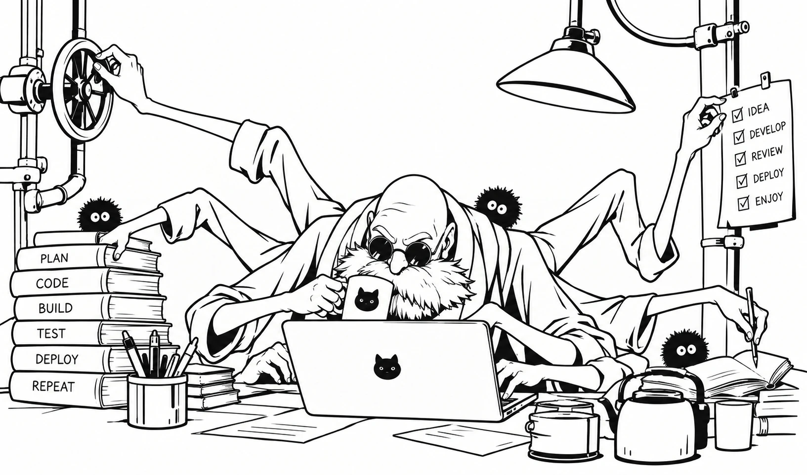

# Kamaji: 제품 개발 하네스



Claude Code와 Codex에서 동작합니다.

> 작업 흐름은 아직 설계 중입니다. 지금은 설치만 동작합니다.

## 설치

프로젝트 루트에서 실행합니다. 다시 실행하면 업데이트됩니다.

```bash
curl -fsSL https://raw.githubusercontent.com/hakan-j-dev/Kamaji/main/install.sh | bash
```

## 설치하면 바뀌는 것

- `.kamaji/`가 생깁니다. 업데이트하면 교체되므로 직접 고치지 않습니다.
- `AGENTS.md` 끝에 Kamaji 진입 규칙이 추가됩니다.
- `CLAUDE.md` 맨 위에 `@AGENTS.md` 한 줄이 추가됩니다.

기존 내용은 바꾸지 않습니다.

## 제거

```bash
curl -fsSL https://raw.githubusercontent.com/hakan-j-dev/Kamaji/main/install.sh | bash -s -- --uninstall
```

## Thanks to

[pstack](https://github.com/cursor/plugins/tree/main/pstack) (Lauren Tan)

## License

MIT
